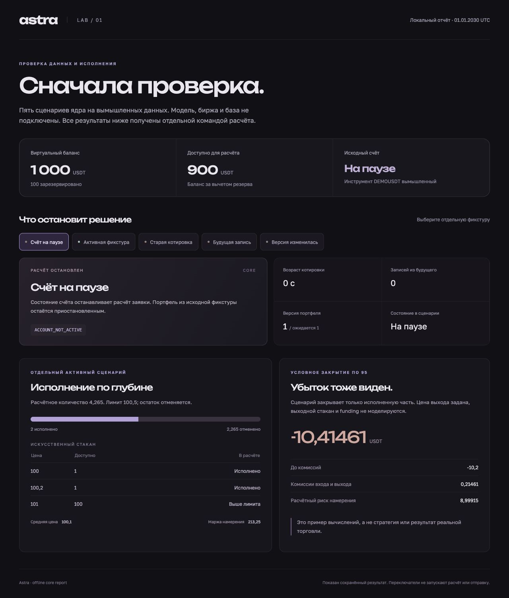
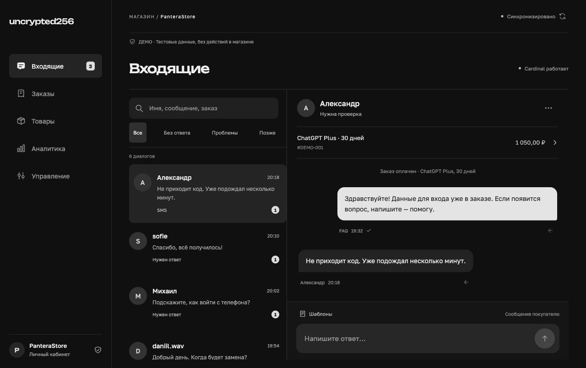
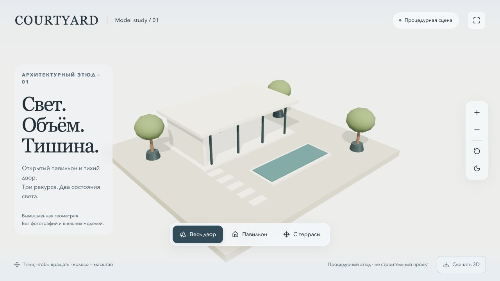
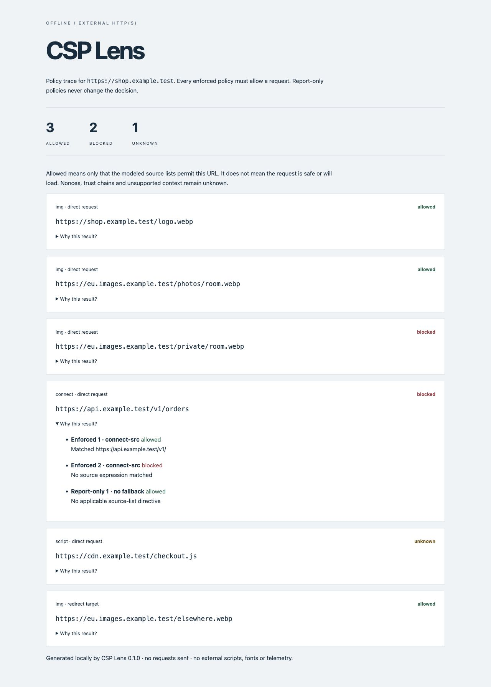
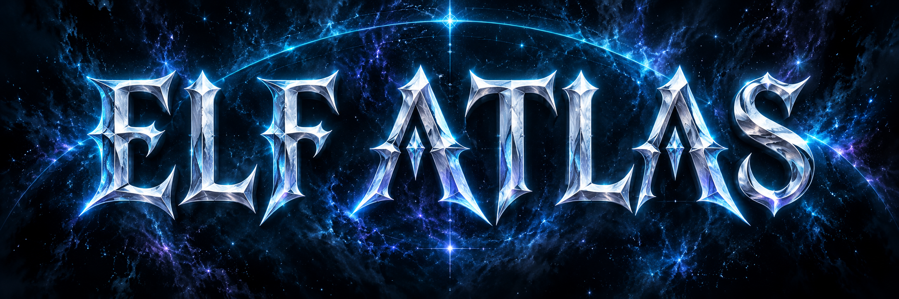
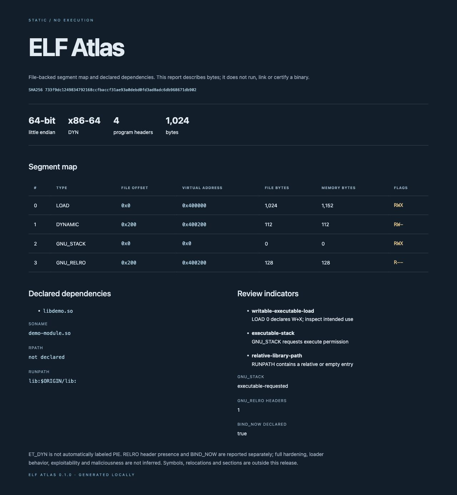
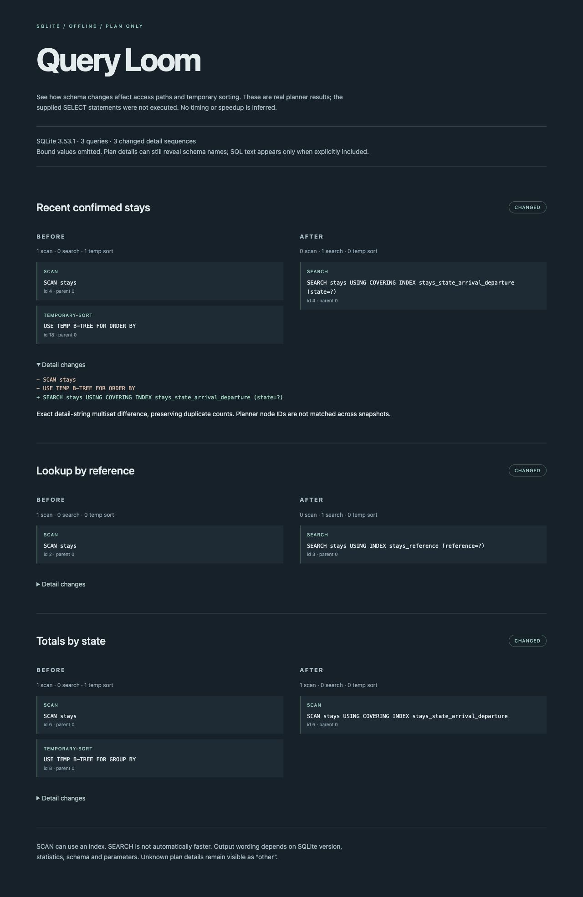
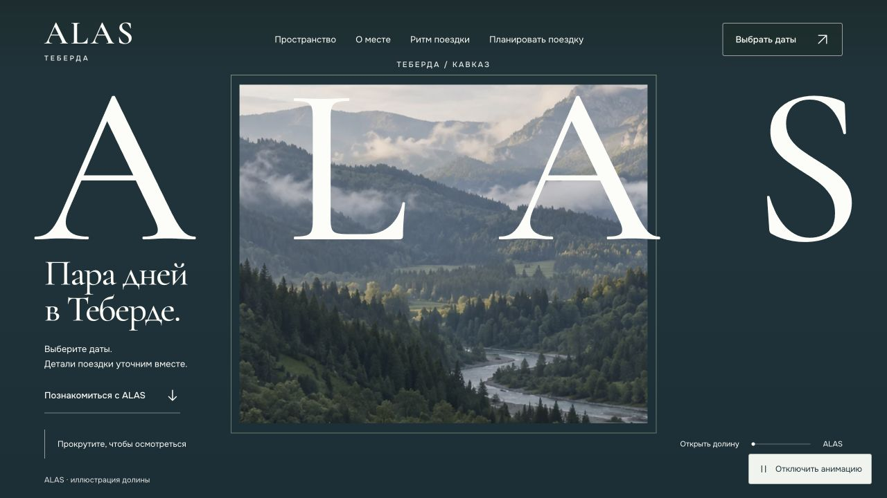
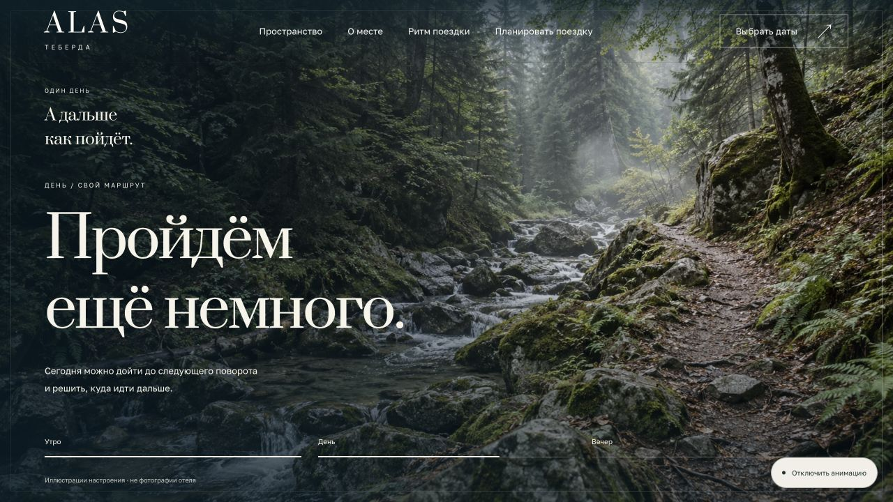
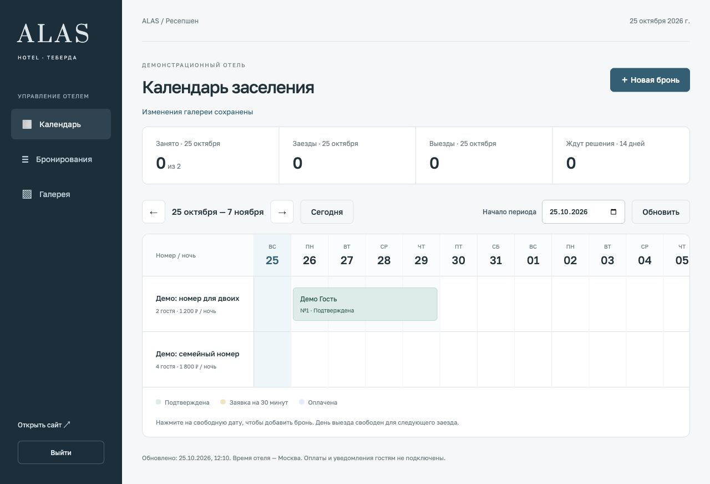

Проекты ниже

[uncrypted.fun](https://uncrypted.fun) · [admin@uncrypted.fun](mailto:admin@uncrypted.fun)

Исходники приложений пока лежат в приватных репах. Если хотите потыкать демо или покопаться в сурсах, пишите на почту выше. Лучше сразу уточнить, какой именно проект интересует, а то их тут уже прилично накопилось.
С демками, кстати, есть небольшой нюанс. Некоторые работают локально, на тестовых данных, без подключения к реальным сервисам. Что именно доступно в каждом проекте и какие есть ограничения, я постарался расписать в описаниях. Чтобы потом не возникало вопросов, почему одно работает, а другое существует исключительно в теории.
Без вмешательства святого SI(AI), конечно, не обошлось. Данный персонаж успел приложить руку к фронту и некоторым частям логики на бэке. Сам тоже местами вайбкодил, чего уж скрывать. Причём степень его участия везде разная, поэтому записывать на его счёт вообще всё было бы несправедливо. Хотя он, наверное, не возражал бы.
С фронтом, кстати, вышло по-разному. Часть его творений я впоследствии переписал практически с нуля, а кое-что так и осталось в первозданном виде. В отдельных местах правок оказалось больше, чем самого исходного кода. Некоторые решения даже пережили все мои попытки сделать лучше.

Мой клиент Telegram для iPhone с настройками приватности и интерфейса. В одном приложении собраны работа с несколькими аккаунтами и настройки клиента. Для оформления используется собственный знак 256: объёмная бирюзовая лента на тёмном фоне.

[Репозиторий · private](https://github.com/uncrypted256/256gram)

Аудиокниги и подкасты в одном приложении для Mac. Можно собрать свою библиотеку и продолжать слушать с сохранённого места. Приложение читает метаданные и главы, ищет книги в нескольких каталогах, сохраняет очередь загрузок. Есть рекомендации, таймер сна, скорость воспроизведения и системное управление плеером.

[Репозиторий · private](https://github.com/uncrypted256/slovo)

Ассистент для личного Telegram-аккаунта с локальной памятью и проверкой ответов. Есть воспроизводимое демо без аккаунта и модели: настоящее ядро готовит черновик на искусственном диалоге, блокирует запрещённый контакт и распознаёт повтор события. Отправка не подключена; один фиксированный mock заменяет генерацию. Личные инструкции и переписки исключены из репозитория.

[Репозиторий · private](https://github.com/uncrypted256/personal-assistant)

Рабочая среда для рыночных данных и симуляции торговых решений. Для показа есть отдельный офлайн-отчёт: пять сценариев проверок ядра, частичное исполнение по глубине и пример убытка после комиссий. Числа вычислены на вымышленном инструменте; биржа, модель и база не подключены. Отчёт воспроизводится локально, его переключатели выбирают сохранённые результаты.

[Репозиторий · private](https://github.com/uncrypted256/astra)

Панель управления магазином: каталог, заказы, переписка, закупки и аналитика. Заказ открывается рядом с диалогом, ответ проходит через предпросмотр и подтверждение. Отдельное локальное демо показывает этот маршрут на вымышленных данных: изменения живут только в памяти вкладки. Сервер магазина, Telegram и платежи в показе не подключены.

[Репозиторий · private](https://github.com/uncrypted256/pantera-control)

Фоновый обработчик событий магазина: SQLite-очередь, проверки ответов и передача спорных случаев владельцу. Case, материалы обращения и предложение действия сохраняются атомарно; полученные материалы остаются непроверенными. 33 теста, типы и сборка прошли. Частные инструкции, рабочие базы и Python-плагины внешних операций не включены. Сам worker не отправляет сообщения покупателям; для этого нужен отдельный адаптер.

[Репозиторий · private](https://github.com/uncrypted256/shop-orchestrator)

Отдельный почтовый адрес для каждого сервиса, один ящик для входящих. Telegram-бот управляет адресами владельца в личном чате; экспорт проверяет записи SQLite и атомарно заменяет карту Postfix. Есть демо с временной базой и 25 локальных тестов. Доставка требует отдельно настроенного почтового сервера; реальная почта и Bot API пока не проверялись.

[Репозиторий · private](https://github.com/uncrypted256/private-email-relay)

Браузерная 3D-сцена с тремя ракурсами, дневным и вечерним светом, экспортом GLB. Для демонстрации сделан отдельный вымышленный павильон Courtyard без фотографий и внешних моделей. Камера учитывает reduced motion и узкий экран. Проверены 11 шагов WebGL-сценария и настоящее скачивание модели; исходный частный объект остаётся в закрытом репозитории.

[Репозиторий · private](https://github.com/uncrypted256/model-viewer)

Подготовка текста и WAV для озвучки: сегментация, метрики, обрезка тишины и сборка с паузами. Есть отдельный клиент Fish Audio с локальным предварительным просмотром и явным запуском отправки. Он проверяет формат аудио, ограничивает размер ответа и сохраняет существующие файлы. Пройдены 17 локальных тестов; реальный провайдер пока не вызывался. Веса своей модели, книжные тексты и частные голосовые конфигурации в экспорт не входят.

[Репозиторий · private](https://github.com/uncrypted256/audio-tools)

Анализ сохранённых стаканов и исполнения по глубине с комиссиями. CLI 0.3.0 сохраняет время снимка, отмечает неизвестную свежесть, проверяет схему и создаёт новый отчёт без перезаписи исходника. Небольшие объёмы проходят все нужные уровни. 26 тестов, wheel и чистая установка проверены на вымышленных данных. Это приближённая модель на float с заданным запасом риска; результаты не подтверждают прибыльность. Исходный GUI и публичные адаптеры сохранены, но их работа с биржами в этом проходе не проверялась. Ордеров и переводов средств нет.

[Репозиторий · private](https://github.com/uncrypted256/arbitrage-scanner)

Последовательная оценка двух SGD-классификаторов и majority baseline: сначала прогноз, затем обучение на новой метке. CSV-бенчмарк 0.3.0 проверяет схему, сохраняет исходник и создаёт новый полный отчёт. Причинный порядок scaler и baseline подтверждён тестами. 26 CSV-тестов и установленный CLI проверены вне проекта; пример на 1000 строк совпал с сохранёнными CSV и отчётом. Это синтетический набор, качество на другом потоке не установлено. Legacy-модули в этот прогон не входят.

[Репозиторий · private](https://github.com/uncrypted256/stream-learning-lab)

Разбор URL-правил Content Security Policy: какое правило разрешает или блокирует ресурс и что меняется при нескольких политиках. Действующие правила проверяются вместе, report-only показаны отдельно. Есть объяснения по каждому ресурсу и офлайн HTML-отчёт. Для nonce, hash и strict-dynamic без нужного контекста остаётся явный unknown. Python без runtime-зависимостей, 19 тестов и чистая установка пакета. Полный браузерный движок и проверка безопасности сайта в этот инструмент не входят.

[Репозиторий · private](https://github.com/uncrypted256/csp-lens)

Статический инспектор ELF32/64: сегменты, виртуальные адреса, объявленные библиотеки и пути поиска. Работает с обоими порядками байтов, показывает права R/W/X и отдельные GNU-индикаторы. Файл не запускается; неоднозначные адреса и выход за границы дают явную ошибку. 17 тестов, чистая установка CLI и собственный C-пример, скомпилированный в ELF-объект и прочитанный без выполнения. Disassembly и вывод о безопасности файла не заявляются.

[Репозиторий · private](https://github.com/uncrypted256/elf-atlas)

Сравнение SQLite EXPLAIN QUERY PLAN на двух офлайн-снимках базы. Видно, где появился индекс, остался scan или исчезла временная сортировка. Переданные SELECT не выполняются, параметры в отчёт не попадают; SQL включается отдельно. В примере три настоящих плана на 1000 вымышленных записях. 21 тест и чистая установка пакета. Поддерживаются самостоятельные rollback-journal snapshots; это анализ планов без замера ускорения.

[Репозиторий · private](https://github.com/uncrypted256/query-loom)

Офлайн-инструменты для метаданных PE, PCAPNG/TLS, Firewall и JSONL-журналов. Бинарники и записанный трафик не выполняются. Сравнение двух снимков отделяет новые HTTP-группы и значения полей от изменения частот; по умолчанию показывает числа, приватные поля включаются отдельно. Для compare прошли 22 теста и чистая установка CLI на двух искусственных снимках. В README есть воспроизводимые примеры пяти проверенных команд. Подлинность журналов, причины изменений, расшифровка и Authenticode не устанавливаются.

[Репозиторий · private](https://github.com/uncrypted256/reverse-engineering-lab)

Офлайн-лицензирование на Ed25519: подпись манифеста, проверка срока, статуса и переданного хеша устройства. Самостоятельный Node.js CLI без зависимостей npm. Генерация сохраняет существующие ключи и откатывает новую приватную часть при конфликте публичного файла; чтение входов ограничено по байтам. Пройдены 18 тестов, включая два параллельных генератора и полный CLI-цикл на временных ключах. Сервер выдачи, загрузчик и сбор идентификаторов в эту версию не входят; отзыв лицензий извне не отслеживается.

[Репозиторий · private](https://github.com/uncrypted256/atlas-license-kit)

Инспектор JAR: состав, хеши, дубли путей, идентификаторы классов и главный раздел манифеста. Повреждённые записи отмечаются отдельно, остальные читаются дальше. Файлы не извлекаются, классы не запускаются, существующие отчёты не заменяются. Есть локальное демо и 23 теста. JVM-верификация и криптографическая проверка подписей в эту версию не входят.

[Репозиторий · private](https://github.com/uncrypted256/jar-audit-tools)

Планирование поиска и сравнение сохранённых предложений перелёта по маршруту, бюджету и длительности. Точный расчёт общей цены не зависит от Decimal-контекста вызывающей программы; новый JSON-отчёт сохраняет исходные файлы. Есть вымышленный пример и 23 теста. Живые цены, наличие мест и бронирование не подключены.

[Репозиторий · private](https://github.com/uncrypted256/flight-search-tools)

Сайт Alas в Теберде и панель управления отелем. В новом моушене пейзаж раскрывается из рамки ALAS, стены и пол собираются вокруг окна, лес появляется внутри крупных букв, а кадры дня разворачиваются в перспективе. Движение обратимо, есть статический режим. Cormorant Garamond и Onest с кириллицей, прохладная палитра, общие SVG-иконки и обновлённая панель дат. Сгенерированные иллюстрации служат концепцией; это не фотографии отеля. Календарь на 14 дней, создание и поиск броней, подтверждение и отмена, загрузка фото/видео через приватные черновики в галерею. Next.js, Prisma, SQLite и sharp; 38 серверных тестов предыдущего прохода, новая production-сборка и браузерные проверки 375/768/1280 px. Настоящие фотографии и тарифы, оплаты, уведомления и внешнее развёртывание ещё нужны.

[Репозиторий · private](https://github.com/uncrypted256/alas-hotel)

Операционная часть магазина на Django: каталог на трёх языках, зашифрованный склад, резервирование и выдача товара, промокоды, поддержка и журнал действий. Панель Atlas Control защищена паролем и TOTP. Восстановлены настройки и локальный сценарий на искусственных заказах; прошли 77 тестов. Покупательский бот, реальные платежи и отправка сообщений ещё не подключены. Недоступная интеграция оставляет явную ошибку и не имитирует успешную операцию.

[Репозиторий · private](https://github.com/uncrypted256/ai-store)

Сайт с галереей, видеоблоком и страницами контактов. Сохранены страницы, адаптивная навигация, SEO-маршруты и галерея. Контакты задаются переменными окружения. Недостающие фото и видео обозначены в README; по умолчанию используется абстрактная SVG-подложка.

[Репозиторий · private](https://github.com/uncrypted256/kymsha)

Мини-апка VPN-сервиса: тарифы, кабинет, инструкции и поддержка. Новый кабинет подключён к локальному API: вход, серверные сессии, каталог и собственные черновики по цене из базы. Есть воспроизводимый стенд с вымышленным аккаунтом. Проверены 49 Python-тестов, 6 тестов клиента и браузерный цикл входа, повторного сохранения и выхода. Настоящие Telegram-аккаунты, PostgreSQL native и production-развёртывание ещё не проверены. Оплата и выдача VPN-доступа не подключены.

[Репозиторий · private](https://github.com/uncrypted256/eliya-vpn)

Проверка исходников перед публикацией. Находит возможные секреты и личные файлы, отмечает зависимости, кэши и дубли. Составляет план проверки без изменения исходников; значения найденных токенов в отчёт не попадают. Поддерживает UTF-8, UTF-16 и текстовые схемы Prisma. Python 3.12, без зависимостей для CLI; 16 локальных тестов.

[Репозиторий · private](https://github.com/uncrypted256/repo-preflight)
