
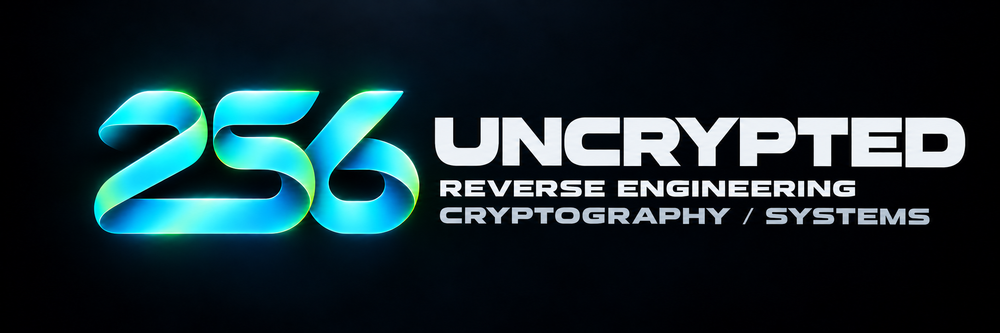

Пишу приложения и инструменты для своих задач. Здесь собраны мои проекты и эксперименты с кодом.

[uncrypted.fun](https://uncrypted.fun) · [admin@uncrypted.fun](mailto:admin@uncrypted.fun)

Исходники приложений находятся в приватных репозиториях. Для просмотра нужен доступ.

<a href="https://github.com/uncrypted256/256gram">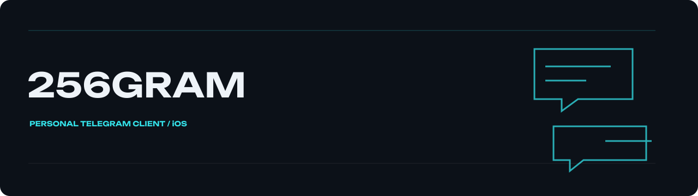</a>

Мой клиент Telegram для iPhone с настройками приватности и интерфейса. В одном приложении собраны работа с несколькими аккаунтами и настройки клиента. Для оформления используется собственный знак 256: объёмная бирюзовая лента на тёмном фоне.

[Репозиторий · private](https://github.com/uncrypted256/256gram)

Аудиокниги и подкасты в одном приложении для Mac. Можно собрать свою библиотеку и продолжать слушать с сохранённого места. Приложение читает метаданные и главы, ищет книги в нескольких каталогах, сохраняет очередь загрузок. Есть рекомендации, таймер сна, скорость воспроизведения и системное управление плеером.

[Репозиторий · private](https://github.com/uncrypted256/slovo)

<a href="https://github.com/uncrypted256/personal-assistant">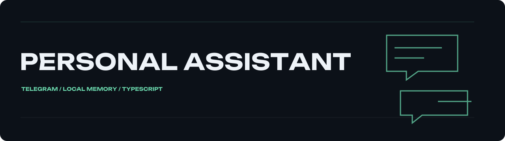</a>

Ассистент для личного Telegram-аккаунта. Помнит контекст каждого диалога и готовит ответы с учётом разрешений собеседника. Работает с текстом, фотографиями, голосовыми сообщениями и видео. Память хранится локально; контекст разделён по аккаунтам и контактам. Ответ проходит проверку перед отправкой. В shadow-режиме отправки нет.

[Репозиторий · private](https://github.com/uncrypted256/personal-assistant)

<a href="https://github.com/uncrypted256/astra">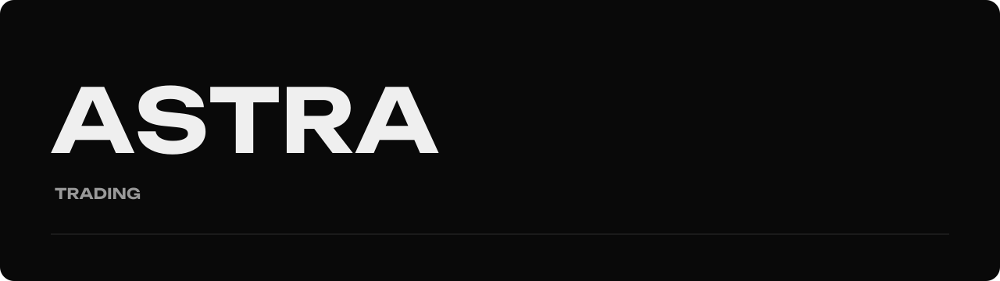</a>

Рабочая среда для рыночных данных и проверки торговых идей в симуляции. Сервер собирает данные, сохраняет аналитические решения вместе с основаниями и ведёт журнал задач. Веб-интерфейс показывает источники и портфели. Есть бумажное исполнение по глубине стакана и наблюдение за подтверждённым демосчётом.

[Репозиторий · private](https://github.com/uncrypted256/astra)

<a href="https://github.com/uncrypted256/pantera-control">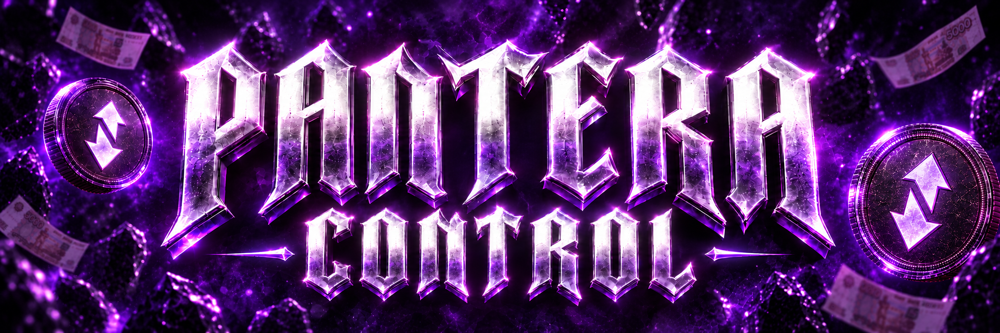</a>

Панель управления магазином: каталог, заказы, переписка, закупки и аналитика. Интерфейс связывает повседневные операции магазина в одном рабочем месте. Для запросов сохраняется состояние; неопределённый ответ сервера не превращается в ложное подтверждение успеха. Деморежим показывает вымышленные заказы и сообщения.

[Репозиторий · private](https://github.com/uncrypted256/pantera-control)

<a href="https://github.com/uncrypted256/shop-orchestrator">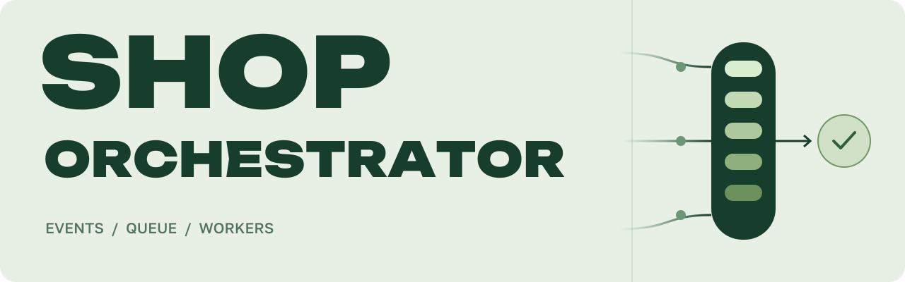</a>

Фоновый обработчик событий магазина: SQLite-очередь, проверки ответов и передача спорных случаев владельцу. Case, материалы обращения и предложение действия сохраняются атомарно; полученные материалы остаются непроверенными. 33 теста, типы и сборка прошли. Частные инструкции, рабочие базы и Python-плагины внешних операций не включены. Сам worker не отправляет сообщения покупателям; для этого нужен отдельный адаптер.

[Репозиторий · private](https://github.com/uncrypted256/shop-orchestrator)

<a href="https://github.com/uncrypted256/private-email-relay">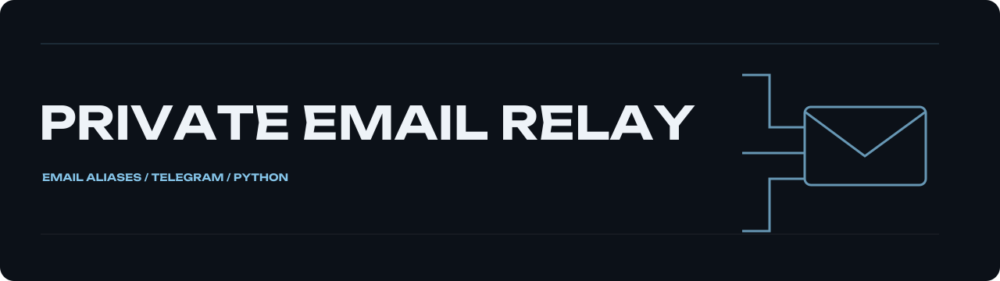</a>

Отдельный почтовый адрес для каждого сервиса, один ящик для входящих. Telegram-бот управляет адресами владельца в личном чате; экспорт проверяет записи SQLite и атомарно заменяет карту Postfix. Есть демо с временной базой и 25 локальных тестов. Доставка требует отдельно настроенного почтового сервера; реальная почта и Bot API пока не проверялись.

[Репозиторий · private](https://github.com/uncrypted256/private-email-relay)

Архитектурная 3D-модель прямо в браузере: ракурс, масштаб и освещение можно менять во время просмотра. Сцена поддерживает переключение камер, дневного и вечернего света, а также экспорт модели. Геометрия и управление сценой выделены в отдельные модули.

[Репозиторий · private](https://github.com/uncrypted256/model-viewer)

Подготовка текста и WAV для озвучки: сегментация, метрики, обрезка тишины и сборка с паузами. Есть отдельный клиент Fish Audio с локальным предварительным просмотром и явным запуском отправки. Он проверяет формат аудио, ограничивает размер ответа и сохраняет существующие файлы. Пройдены 17 локальных тестов; реальный провайдер пока не вызывался. Веса своей модели, книжные тексты и частные голосовые конфигурации в экспорт не входят.

[Репозиторий · private](https://github.com/uncrypted256/audio-tools)

<a href="https://github.com/uncrypted256/arbitrage-scanner">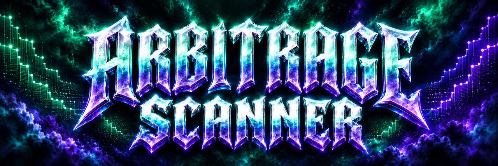</a>

Сканер межбиржевых спредов, который считает исполнение по глубине стакана. Учитывает комиссии, расходы перевода, частичное исполнение и свежесть локального снимка. Есть настольный интерфейс и командная строка для сохранённых стаканов. Можно отдельно запросить публичный снимок рынка.

[Репозиторий · private](https://github.com/uncrypted256/arbitrage-scanner)

<a href="https://github.com/uncrypted256/stream-learning-lab">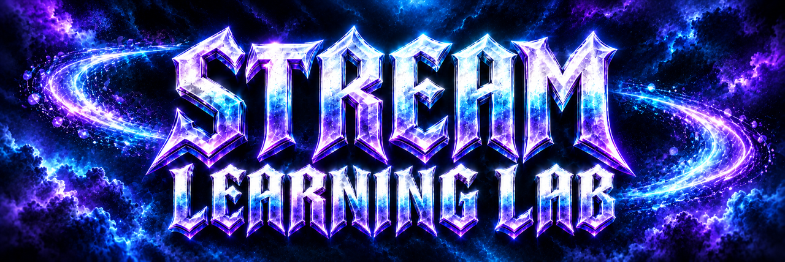</a>

Лаборатория обучения на последовательных данных. Модель сначала делает прогноз, затем получает правильный ответ и обновляется. CSV-бенчмарк сравнивает два SGD-классификатора с базовой стратегией. Синтетический поток меняет правило в середине последовательности, чтобы было видно, как модели адаптируются. Результат сохраняется в JSON и на кривой обучения.

[Репозиторий · private](https://github.com/uncrypted256/stream-learning-lab)

<a href="https://github.com/uncrypted256/reverse-engineering-lab">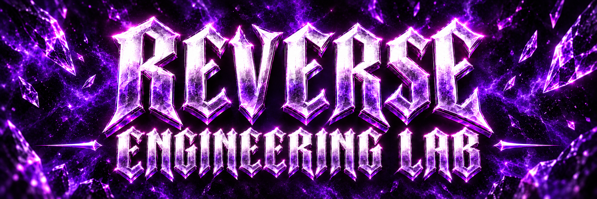</a>

Пять офлайн-инструментов для разбора бинарных файлов, сетевых записей и журналов исследования. Можно получить метаданные PE, сводку PCAPNG, отчёт Windows Firewall, обзор сетевого JSONL и сравнение двух журналов. Отдельные парсеры разбирают доступные DNS/TLS-метаданные. Результаты сохраняются в JSON и читаемых отчётах.

[Репозиторий · private](https://github.com/uncrypted256/reverse-engineering-lab)

<a href="https://github.com/uncrypted256/atlas-license-kit">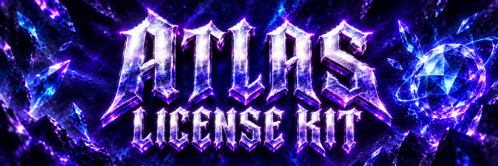</a>

Офлайн-лицензирование на Ed25519: подпись манифеста, проверка срока, статуса и переданного хеша устройства. Самостоятельный Node.js CLI без зависимостей npm. Генерация сохраняет существующие ключи и откатывает новую приватную часть при конфликте публичного файла; чтение входов ограничено по байтам. Пройдены 18 тестов, включая два параллельных генератора и полный CLI-цикл на временных ключах. Сервер выдачи, загрузчик и сбор идентификаторов в эту версию не входят; отзыв лицензий извне не отслеживается.

[Репозиторий · private](https://github.com/uncrypted256/atlas-license-kit)

<a href="https://github.com/uncrypted256/jar-audit-tools">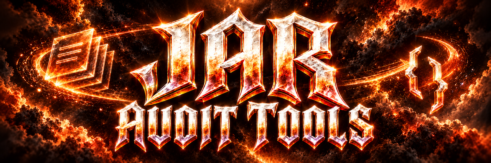</a>

Инспектор JAR: состав, хеши, дубли путей, идентификаторы классов и главный раздел манифеста. Повреждённые записи отмечаются отдельно, остальные читаются дальше. Файлы не извлекаются, классы не запускаются, существующие отчёты не заменяются. Есть локальное демо и 23 теста. JVM-верификация и криптографическая проверка подписей в эту версию не входят.

[Репозиторий · private](https://github.com/uncrypted256/jar-audit-tools)

<a href="https://github.com/uncrypted256/flight-search-tools">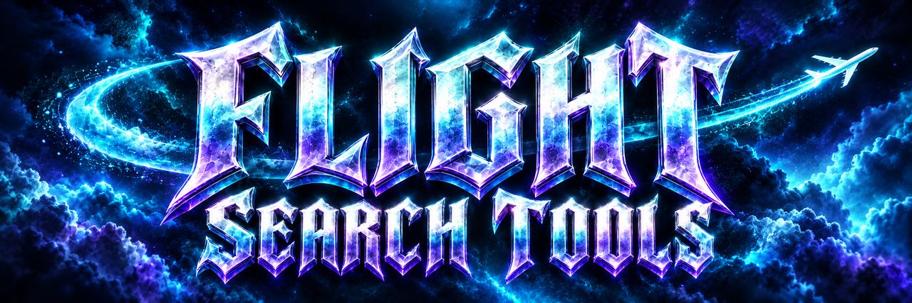</a>

Планирование поиска и сравнение сохранённых предложений перелёта по маршруту, бюджету и длительности. Точный расчёт общей цены не зависит от Decimal-контекста вызывающей программы; новый JSON-отчёт сохраняет исходные файлы. Есть вымышленный пример и 23 теста. Живые цены, наличие мест и бронирование не подключены.

[Репозиторий · private](https://github.com/uncrypted256/flight-search-tools)

Сайт отеля в Теберде. Строки заголовка появляются из маски, прокрутка меняет свет в долине, панорама и раздел «Ритм поездки» продолжают движение. GSAP, обычная прокрутка и кнопка отключения анимации; 60 кадров Remotion доступны для сравнения. Next.js и Prisma отвечают за проверку дат, отдельную заявку, подтверждение и отмену с историей. Повтор после потери ответа возвращает ту же квитанцию. Пройдены 28 тестов, production-сборка и браузерные проверки, включая ширины 375 и 768 пикселей. В демо вымышленные номера и цены, сгенерированный пейзаж. Рабочие фотографии, тарифы и внешнее развёртывание ещё нужны; оплат и уведомлений нет.

[Репозиторий · private](https://github.com/uncrypted256/alas-hotel)

Операционная часть магазина на Django: каталог на трёх языках, зашифрованный склад, резервирование и выдача товара, промокоды, поддержка и журнал действий. Панель Atlas Control защищена паролем и TOTP. Восстановлены настройки и локальный сценарий на искусственных заказах; прошли 77 тестов. Покупательский бот, реальные платежи и отправка сообщений ещё не подключены. Недоступная интеграция оставляет явную ошибку и не имитирует успешную операцию.

[Репозиторий · private](https://github.com/uncrypted256/ai-store)

Сайт с галереей, видеоблоком и страницами контактов. Сохранены страницы, адаптивная навигация, SEO-маршруты и галерея. Контакты задаются переменными окружения. Недостающие фото и видео обозначены в README; по умолчанию используется абстрактная SVG-подложка.

[Репозиторий · private](https://github.com/uncrypted256/kymsha)

Мини-апка VPN-сервиса: тарифы, кабинет, инструкции и поддержка. Новый кабинет подключён к локальному API: вход, серверные сессии, каталог и собственные черновики по цене из базы. Есть воспроизводимый стенд с вымышленным аккаунтом. Проверены 49 Python-тестов, 6 тестов клиента и браузерный цикл входа, повторного сохранения и выхода. Настоящие Telegram-аккаунты, PostgreSQL native и production-развёртывание ещё не проверены. Оплата и выдача VPN-доступа не подключены.

[Репозиторий · private](https://github.com/uncrypted256/eliya-vpn)

<a href="https://github.com/uncrypted256/repo-preflight">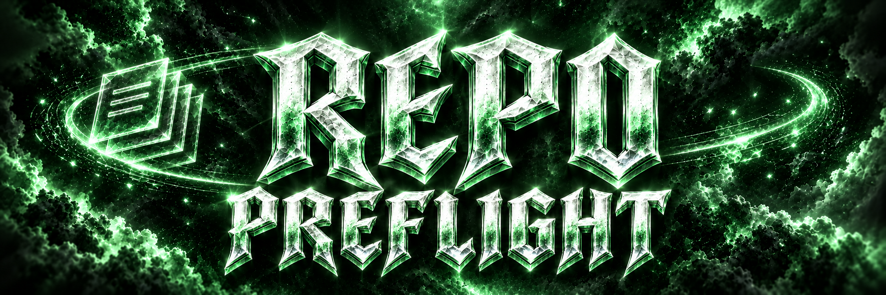</a>

Проверка исходников перед публикацией. Находит возможные секреты и личные файлы, отмечает зависимости, кэши и дубли. Составляет план проверки без изменения исходников; значения найденных токенов в отчёт не попадают. Поддерживает UTF-8, UTF-16 и текстовые схемы Prisma. Python 3.12, без зависимостей для CLI; 16 локальных тестов.

[Репозиторий · private](https://github.com/uncrypted256/repo-preflight)
